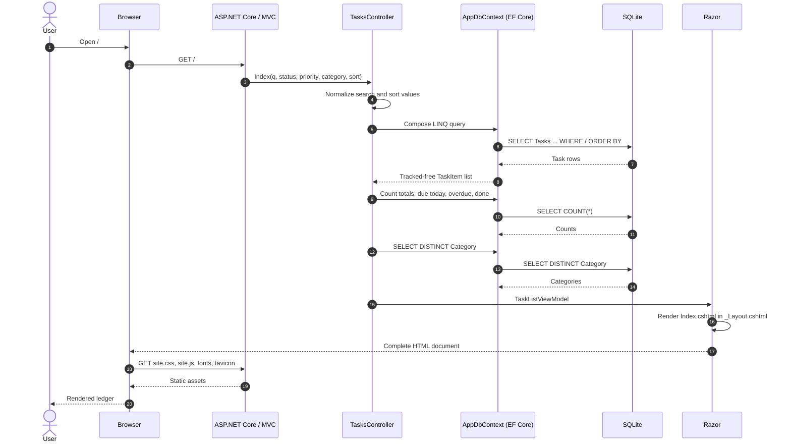
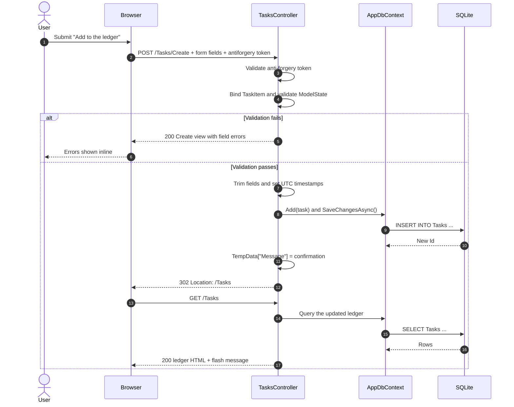
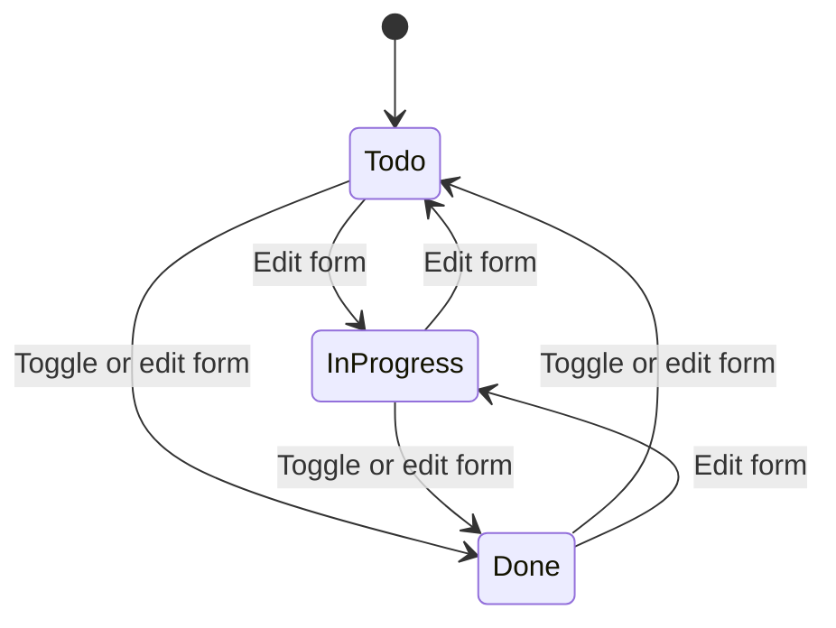

# Application Workflow

This document traces a request through Tandem, from the HTML the browser receives back to
the SQLite rows it came from. It covers the front-end views and interactions, the MVC and
EF Core layers in the middle, and the database at the bottom.

- [1. The short version](#1-the-short-version)
- [2. Technology and project map](#2-technology-and-project-map)
- [3. Startup and request pipeline](#3-startup-and-request-pipeline)
- [4. Page load: HTML to SQLite and back](#4-page-load-html-to-sqlite-and-back)
- [5. Writes: forms, validation, and redirects](#5-writes-forms-validation-and-redirects)
- [6. Endpoints and what they do](#6-endpoints-and-what-they-do)
- [7. The front-end layer](#7-the-front-end-layer)
- [8. The back-end layer](#8-the-back-end-layer)
- [9. Data model and SQLite storage](#9-data-model-and-sqlite-storage)
- [10. Task state transitions](#10-task-state-transitions)
- [11. Search, filtering, and sorting](#11-search-filtering-and-sorting)
- [12. Validation, security, and errors](#12-validation-security-and-errors)
- [13. End-to-end walkthroughs](#13-end-to-end-walkthroughs)
- [14. Where to make changes](#14-where-to-make-changes)

---

## 1. The short version

Tandem is a server-rendered ASP.NET Core MVC application. There is no SPA, no client-side
router, and no API layer that the browser calls with JSON.

```text
Browser
  │  GET /Tasks?status=Todo
  ▼
Kestrel / ASP.NET Core middleware
  │  routing selects TasksController.Index
  ▼
TasksController
  │  builds a LINQ query
  ▼
AppDbContext (EF Core)
  │  translates LINQ to SQL
  ▼
Data/tandem.db (SQLite)
  │  rows
  ▼
TaskListViewModel
  │  Razor renders Views/Tasks/Index.cshtml inside _Layout.cshtml
  ▼
HTML + CSS + small progressive-enhancement script
  ▼
Browser paints the ledger
```

Writes follow the same path in reverse:

```text
Form POST → anti-forgery check → model binding → validation → EF Core write
→ TempData flash message → 302 redirect → fresh GET of the ledger
```

The database is the only durable state. Filter values live in the query string, the
current page is plain HTML, and JavaScript only improves interactions that already work
without it.

---

## 2. Technology and project map

| Layer | Technology |
| --- | --- |
| Web server | Kestrel, ASP.NET Core MVC on `net10.0` |
| View engine | Razor (`.cshtml`) |
| Data access | EF Core 10 with the SQLite provider |
| Database | SQLite file at `Data/tandem.db` |
| Styling | Bootstrap base plus custom CSS in `wwwroot/css/site.css` |
| Client behavior | Vanilla JavaScript in `wwwroot/js/site.js` |
| Validation | DataAnnotations, jQuery Validation, and server-side ModelState |

Request-relevant files:

```text
Program.cs                          composition root, middleware, database startup
appsettings.json                    SQLite connection string
Data/AppDbContext.cs                DbSet<TaskItem> and indexes
Data/DbSeeder.cs                    first-run sample tasks
Data/Migrations/                    schema history
Models/TaskItem.cs                  entity, enums, display helpers
Models/TaskListViewModel.cs         ledger data + summary counts
Controllers/TasksController.cs      all task actions
Views/Tasks/Index.cshtml            ledger screen
Views/Tasks/_TaskFormFields.cshtml  shared create/edit fields
Views/Tasks/Create.cshtml           create screen
Views/Tasks/Edit.cshtml             edit screen
Views/Tasks/Details.cshtml          single-task screen
Views/Tasks/Delete.cshtml           delete confirmation
Views/Shared/_Layout.cshtml         shell, masthead, footer, flash, scripts
wwwroot/css/site.css                visual system and responsive rules
wwwroot/js/site.js                  filters, flash, shortcuts, confirms
```

---

## 3. Startup and request pipeline

`Program.cs` runs in this order:

1. Create the application builder and register MVC with `AddControllersWithViews()`.
2. Read `ConnectionStrings:DefaultConnection` from configuration, falling back to
   `Data Source=Data/tandem.db`.
3. Ensure the `Data` directory exists.
4. Register `AppDbContext` with `UseSqlite(...)`.
5. Build the application.
6. Open a service scope, resolve `AppDbContext`, and call `Database.MigrateAsync()`.
7. Call `DbSeeder.SeedAsync(...)`, which inserts example tasks only when the table is empty.
8. Configure the HTTP pipeline.
9. Start Kestrel with `app.Run()`.

The pipeline is:

```text
Exception handler (production)
HSTS (production)
HTTPS redirection
Routing
Authorization
Static asset endpoints (MapStaticAssets)
Controller route endpoints
```

The default route is:

```text
{controller=Tasks}/{action=Index}/{id?}
```

So `/` and `/Tasks` both reach `TasksController.Index`. `/Home` is also handled:
`HomeController.Index` redirects to the ledger.

Database startup happens before the server accepts requests. On a fresh checkout, this
means the schema and sample tasks exist by the time the first page loads.

---

## 4. Page load: HTML to SQLite and back



### Step by step

1. **Browser sends a GET request.** Filters and sort choices are query-string parameters,
   for example `/Tasks?status=InProgress&priority=High&sort=due`.

2. **Middleware handles the request.** HTTPS redirection, routing, and endpoint selection
   run before the controller. In production, exception handling and HSTS wrap the request.

3. **Model binding fills action parameters.** Query keys map to `Index` parameters:
   `q`, `status`, `priority`, `category`, and `sort`.

4. **The controller prepares input.** It trims the search term, caps it at 100 characters,
   and resets unknown sort values to `due`.

5. **EF Core composes the query.** Each active filter adds a `Where` clause. Sorting is
   applied with `OrderBy` / `ThenBy`, always keeping completed tasks below open tasks.

6. **SQLite executes parameterized SQL.** The result is materialized as `TaskItem` objects.
   Read-only queries use `AsNoTracking()` because the page never updates those entities.

7. **Summary data is gathered.** Separate count queries produce total, to-do, in-progress,
   done, due-today, and overdue numbers. A distinct query supplies category choices.

8. **A view model is created.** `TaskListViewModel` carries the task list, categories,
   summary, current filters, and sort mode to the view.

9. **Razor renders HTML.** `Views/Tasks/Index.cshtml` renders the rail, stats, toolbar,
   and task rows. `Views/_ViewStart.cshtml` wraps it in `Views/Shared/_Layout.cshtml`.
   Tag helpers generate URLs, form actions, and anti-forgery tokens.

10. **The browser requests static assets.** CSS, JavaScript, fonts, and the favicon arrive
    as separate requests. `asp-append-version` adds a content hash to local assets for
    cache busting.

11. **JavaScript enhances the page.** It does not fetch data. It adds auto-submitting
    filters, flash dismissal, keyboard shortcuts, and confirmation prompts.

---

## 5. Writes: forms, validation, and redirects

Every write uses the Post/Redirect/Get pattern so refreshing the result does not repeat
the mutation.



Key mechanics:

- **Anti-forgery.** All POST actions carry `[ValidateAntiForgeryToken]`. The form tag helper
  injects the hidden token. A missing or stale token produces a 400 response.
- **Model binding.** Form field names match entity properties (`Title`, `Category`, etc.).
  Enum fields bind from their names (`Todo`, `InProgress`, `Done`, `Low`, `Medium`, `High`).
- **Validation.** DataAnnotations run during binding. If `ModelState` is invalid, the same
  view is returned with the submitted values and error messages. Create/Edit also load the
  validation scripts for immediate client-side feedback.
- **Normalization.** Titles, notes, and categories are trimmed before validation and save.
  Empty optional values are stored as `NULL` rather than empty strings.
- **Timestamps.** `CreatedAt` and `UpdatedAt` are UTC. `CompletedAt` is set when a task
  enters `Done` and cleared when it leaves `Done`.
- **Flash messages.** `TempData["Message"]` survives the redirect and is rendered by
  `_Layout.cshtml` as a dismissible notification.
- **Filters survive redirects.** Inline toggles include a hidden `returnUrl` built from the
  current path and query string. The controller accepts it only if `Url.IsLocalUrl(...)`
  returns true, preventing open redirects.

---

## 6. Endpoints and what they do

| Method | Route | Action | Behavior |
| --- | --- | --- | --- |
| GET | `/` or `/Tasks` | `Index` | Filtered, sorted ledger plus summary |
| GET | `/Tasks/Details/{id}` | `Details` | Single task, 404 if missing |
| GET | `/Tasks/Create` | `Create` | Blank form and category suggestions |
| POST | `/Tasks/Create` | `Create` | Validate, insert, flash, redirect |
| GET | `/Tasks/Edit/{id}` | `Edit` | Prefilled form, 404 if missing |
| POST | `/Tasks/Edit/{id}` | `Edit` | Validate, update, manage completion, redirect |
| POST | `/Tasks/Toggle` | `Toggle` | Flip done state using form `id` and `returnUrl` |
| GET | `/Tasks/Delete/{id}` | `Delete` | Confirmation screen |
| POST | `/Tasks/Delete/{id}` | `DeleteConfirmed` | Remove one task and redirect |
| POST | `/Tasks/ClearCompleted` | `ClearCompleted` | Remove every task with status `Done` |

`Toggle` and `ClearCompleted` are form-only POST actions. There is no GET route that
mutates data. `ClearCompleted` asks for confirmation in the browser; if JavaScript is
disabled, the action still runs because the confirmation is progressive enhancement.

---

## 7. The front-end layer

### 7.1 Views

Razor renders everything on the server. The layout provides the document shell and the
task views provide the page body.

```text
Views/Shared/_Layout.cshtml
├── <head>: fonts, Bootstrap, site.css, favicon
├── masthead: brand, tagline, ledger link, New task button
├── <main>: @RenderBody()
├── footer
├── flash message from TempData
└── jQuery, Bootstrap JS, site.js, optional Scripts section
```

- `_ViewStart.cshtml` selects `_Layout` for every view.
- `_ViewImports.cshtml` imports `MvcApp` namespaces and the tag helpers.
- `Index.cshtml` is strongly typed to `TaskListViewModel`.
- `Details.cshtml` and `Delete.cshtml` bind to `TaskItem`.
- `Create.cshtml` and `Edit.cshtml` share `_TaskFormFields.cshtml`.
- `Create` and `Edit` opt into `_ValidationScriptsPartial` via `@section Scripts`.

### 7.2 Server-generated links and forms

Tag helpers keep URLs aligned with routing:

- `asp-action`, `asp-route-id`, and `asp-route-*` generate filter-preserving links.
- `asp-for` generates field names, ids, values, and validation attributes.
- `asp-validation-for` renders field-level error slots.
- Forms automatically receive the anti-forgery token.
- `asp-append-version` cache-busts local CSS and JavaScript.

### 7.3 Styling

Bootstrap supplies a small baseline reset and utilities. `site.css` supplies the actual
visual language: warm paper backgrounds, Fraunces display type, Karla body type, mono
metadata, vermilion accents, hairline rules, and a responsive two-column-to-single-column
layout. The page uses CSS custom properties for the palette and spacing.

The ledger rail becomes a compact grid on tablets and a stacked summary on phones. Task
rows move their actions beneath the title on narrow screens. Animations are reduced to
near-zero when `prefers-reduced-motion` is set.

### 7.4 JavaScript

`wwwroot/js/site.js` is deliberately small and optional:

- Auto-submits the search toolbar when a `<select>` changes.
- Dismisses flash messages after 4.5 seconds or on demand.
- Asks for confirmation on forms marked `data-confirm`.
- Binds `N` to the new-task link and `/` to the search field, ignoring keystrokes while
  typing in inputs, textareas, selects, or content-editable elements.

Without JavaScript, the toolbar still has a Filter button, forms still validate on the
server, delete still has its own confirmation page, and all data remains reachable.

### 7.5 Where UI state comes from

| UI element | Source |
| --- | --- |
| Task rows | `TaskListViewModel.Tasks` from EF Core |
| Completion percentage | `Summary.Done / Summary.Total`, rounded |
| Status and priority counts | Summary count queries |
| Current filter highlight | `Model.Status`, `Model.Priority`, `Model.Category` |
| Search text | `Model.Search` |
| Sort selection | `Model.Sort` |
| Category choices | Distinct non-empty categories in the database |
| Due labels | `DateOnly` values compared with today's date |
| Flash message | One-shot `TempData` value |

---

## 8. The back-end layer

### 8.1 Controller responsibilities

`TasksController` is the single orchestration point for task operations. It depends on
`AppDbContext` through constructor injection.

- **Read actions** use `AsNoTracking()`. They return `NotFound()` when an id does not exist.
- **Write actions** load tracked entities, mutate them, and call `SaveChangesAsync()`.
- **Index** composes the filter/sort query, computes summary counts, and loads categories.
- **Create** builds a new entity from bound input and sets creation timestamps.
- **Edit** maps edited fields onto the existing entity so creation data cannot be
  overposted.
- **Toggle** flips between `Done` and `Todo`, updates `CompletedAt`, and redirects back.
- **Delete** and **ClearCompleted** remove rows and report what happened through TempData.

The controller contains no SQL and no HTML. It deals in entities, view models, and
`IActionResult` values.

### 8.2 EF Core and the context

`AppDbContext` exposes `DbSet<TaskItem> Tasks`. The model configuration adds indexes on
`Status`, `DueDate`, and `Category` for common filters and sorts. There are no
relationships, owned types, or lazy loading in the current model.

Read queries are composable `IQueryable`s until `ToListAsync()` executes them. SQLite sees
parameterized SQL rather than interpolated strings. Writes are unit-of-work operations:
mutate tracked entities, then call `SaveChangesAsync()` once.

### 8.3 Rendering boundary

The controller hands a view model to Razor. Razor reads it, encodes values for HTML, and
produces a complete document. There is no JSON serialization step and no client-side
hydration of task data.

---

## 9. Data model and SQLite storage

`TaskItem` is the only persisted entity.

| Property | CLR type | SQLite storage | Rules |
| --- | --- | --- | --- |
| `Id` | `int` | `INTEGER` primary key | Auto-increment |
| `Title` | `string` | `TEXT` | Required, 3–120 characters |
| `Notes` | `string?` | `TEXT` | Optional, max 2,000 |
| `Category` | `string?` | `TEXT` | Optional, max 50, indexed |
| `Priority` | `TaskPriority` | `INTEGER` | `Low=0`, `Medium=1`, `High=2` |
| `Status` | `TaskState` | `INTEGER` | `Todo=0`, `InProgress=1`, `Done=2` |
| `DueDate` | `DateOnly?` | `TEXT` | Optional, indexed |
| `CreatedAt` | `DateTime` | `TEXT` | UTC |
| `UpdatedAt` | `DateTime` | `TEXT` | UTC |
| `CompletedAt` | `DateTime?` | `TEXT` | Set when entering `Done` |

Computed, non-persisted helpers on the entity keep view logic simple:

- `IsDone` checks `Status == Done`.
- `IsOverdue` checks for an incomplete task with a due date before today.
- `IsDueToday` checks for an incomplete task due today.
- `StatusLabel` adds a readable space to `InProgress`.

### Database lifecycle

```text
First run:
  Data/tandem.db missing
  → create file
  → apply InitialCreate migration
  → table + indexes created
  → seed seven example tasks
  → serve requests

Later runs:
  database exists
  → apply any pending migrations
  → seed skips because Tasks is not empty
  → serve requests

Reset:
  stop app
  → delete Data/tandem.db (and -wal / -shm if present)
  → next run recreates schema and seed data
```

The connection string lives in `appsettings.json`:

```json
"ConnectionStrings": {
  "DefaultConnection": "Data Source=Data/tandem.db"
}
```

---

## 10. Task state transitions



Rules:

- A task starts as `Todo` with `Medium` priority unless the user chooses otherwise.
- Completing a task sets `CompletedAt` to the current UTC time.
- Moving a task out of `Done` clears `CompletedAt`.
- The checkbox toggle is a shortcut between `Done` and `Todo`; it does not restore a
  previous `InProgress` state. Use the edit form to set `InProgress`.
- Completed tasks remain in the database and in the "All tasks" view, sorted after open
  tasks and shown with a struck-through title.

---

## 11. Search, filtering, and sorting

All filtering happens in SQLite through composed EF Core queries.

| Input | Behavior |
| --- | --- |
| `q` | Trimmed, capped at 100 characters, matched with `LIKE %q%` against title, notes, and category |
| `status` | Exact match on `TaskState` |
| `priority` | Exact match on `TaskPriority` |
| `category` | Exact match on the stored category string |
| `sort` | One of `due`, `priority`, `created`, or `title`; unknown values fall back to `due` |

Sort definitions:

| Sort | Order |
| --- | --- |
| `due` | Open before done, null due dates last, earliest due date, higher priority |
| `priority` | Open before done, high to low priority, null due dates last, earliest due date, newest created |
| `created` | Open before done, newest created first |
| `title` | Open before done, alphabetical by title |

The summary strip is independent of filters and always describes the whole ledger:

- **Open tasks** = total minus done
- **Due today** = not done and due date equals today
- **Overdue** = not done and due date is before today
- **Completed** = status `Done`
- **Completion** = rounded `done / total * 100`, or 0 when there are no tasks

Category options come from a distinct query over all tasks, sorted alphabetically, and
are reused by the create/edit form datalist.

---

## 12. Validation, security, and errors

### Validation

- DataAnnotations enforce required titles and maximum lengths.
- Create/Edit re-check the trimmed title length so whitespace padding cannot bypass the
  three-character minimum.
- Client-side validation comes from jQuery Validation plus the unobtrusive adapter.
- Server-side ModelState is always authoritative; disabling JavaScript cannot bypass rules.
- Invalid forms return HTTP 200 with the submitted values and inline errors.

### Security

- Razor HTML-encodes output, preventing stored script injection through titles or notes.
- EF Core parameterizes all values, preventing SQL injection.
- Every mutating action validates an anti-forgery token.
- `returnUrl` redirects are accepted only when `Url.IsLocalUrl(...)` is true.
- HTTPS redirection is always enabled; HSTS and the shared exception handler are enabled
  outside Development.
- There is no authentication or authorization. The app is single-user by design, and the
  SQLite file is the security boundary for the data.

### Error behavior

| Situation | Result |
| --- | --- |
| Missing id in Details/Edit/Delete/Toggle | HTTP 404 |
| Invalid form input | HTTP 200 with validation messages |
| Invalid anti-forgery token | HTTP 400 |
| Production exception | Redirect to `/Home/Error` |
| Unknown sort value | Falls back to `due` |
| Unknown enum query value | Ignored by binding, so the filter is not applied |

---

## 13. End-to-end walkthroughs

### 13.1 Load the ledger

```text
GET /Tasks?status=InProgress&sort=priority
→ routing selects TasksController.Index
→ q=null, status=InProgress, priority=null, category=null, sort=priority
→ EF Core: WHERE Status = 1 ORDER BY (Status = 2), Priority DESC, ...
→ summary counts and categories are queried
→ TaskListViewModel is rendered by Index.cshtml
→ browser receives the rail, stats, toolbar, and task rows
```

### 13.2 Create a task

```text
GET /Tasks/Create
→ blank TaskItem + category suggestions
→ user fills title "Write the release note"
→ browser POSTs the form with the anti-forgery token
→ ModelState validates
→ controller trims fields, sets CreatedAt/UpdatedAt in UTC
→ EF Core INSERTs the row
→ TempData stores "“Write the release note” was added to the ledger."
→ 302 to /Tasks
→ GET /Tasks renders the new row and the flash message
```

### 13.3 Complete a task from the ledger

```text
user clicks the circular checkbox on a row
→ POST /Tasks/Toggle with id and returnUrl=/?status=Todo&sort=due
→ controller loads the task, sets Status=Done and CompletedAt=now
→ TempData stores a completion message
→ 302 back to the local returnUrl
→ ledger rerenders with the same filters and the row struck through
```

### 13.4 Edit a task

```text
GET /Tasks/Edit/3
→ task 3 loaded without tracking and prebound to the form
→ user changes priority to High and status to InProgress
→ POST /Tasks/Edit/3
→ controller loads the tracked entity, maps allowed fields, sets UpdatedAt
→ CompletedAt is cleared if the task left Done
→ 302 to /Tasks with a confirmation flash
```

### 13.5 Delete a task

```text
GET /Tasks/Delete/3
→ confirmation screen shows title, category, status, and due date
→ POST /Tasks/Delete/3 with anti-forgery token
→ row removed and SaveChangesAsync commits
→ 302 to /Tasks with a deletion flash
```

---

## 14. Where to make changes

### Add a field to tasks

1. Add the property and validation attributes to `Models/TaskItem.cs`.
2. Add a migration:
   ```powershell
   dotnet ef migrations add AddTaskField --output-dir Data/Migrations
   ```
3. Add the input to `Views/Tasks/_TaskFormFields.cshtml`.
4. Include the property in the `[Bind(...)]` lists in `TasksController.Create` and `Edit`.
5. Display it in `Views/Tasks/Index.cshtml` and/or `Details.cshtml`.
6. Add any needed column or style rules to `wwwroot/css/site.css`.

### Add a new filter

1. Add a parameter to `TasksController.Index`.
2. Add a `Where` clause to the `IQueryable`.
3. Preserve the value in rail/toolbar links and hidden form fields.
4. Add the control to `Views/Tasks/Index.cshtml`.
5. Decide whether "Clear filters" should reset it.

### Replace SQLite with another provider

1. Replace the `Microsoft.EntityFrameworkCore.Sqlite` package.
2. Change `UseSqlite(...)` in `Program.cs`.
3. Regenerate migrations for the new provider.
4. Review type mappings such as `DateOnly`, `DateTime`, and enum storage.

### Add authentication later

The current controller assumes one shared ledger. Multi-user support would require:

- A user entity and sign-in flow.
- A `UserId` foreign key on `TaskItem`.
- Query filters scoped to the signed-in user.
- Authorization checks on every read and write by id.
- Migrations that assign existing tasks to a first user.

Until then, keep the app bound to localhost or a trusted network, and treat
`Data/tandem.db` as the entire data store.
